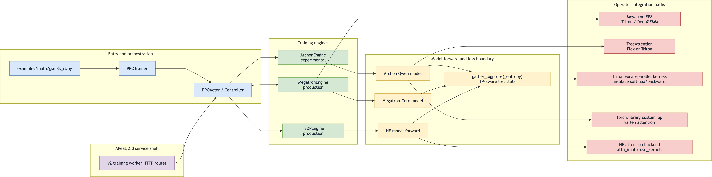

# AReaL 学习路线与底层算子接入

本文基于当前 `main` 分支整理，重点回答两个问题：AReaL 的代码应该从哪里开始读，以及一个底层算子如何接入模型、并行训练和 PPO 训练循环。

## 先给结论

AReaL 本质上是一个异步 RL 训练系统，不是单独的 CUDA 算子库。底层算子主要分布在三条路径：

1. 通过配置接入第三方实现，例如 Hugging Face Kernels、FlashAttention 和 SDPA。
2. 在 Python 中封装 Triton 或 PyTorch 自定义算子，例如词表并行、变长注意力和 FP8。
3. 把算子嵌入 FSDP、Megatron、Archon、激活检查点和 `torch.compile` 等训练基础设施。

推荐的整体阅读顺序是：

```text
GSM8K 示例
  -> PPOTrainer
  -> PPOActor
  -> FSDP / Megatron / Archon Engine
  -> 模型 forward
  -> logprob / loss
  -> attention / Triton / custom_op / FP8
  -> backward + optimizer
  -> 权重同步到 rollout engine
```

调用关系图：



可编辑源文件：[operator_learning_path.drawio](../../figures/operator_learning_path.drawio)。

## 一、先从哪里开始

### 1. 最小训练入口

先读以下三个文件：

- [`examples/math/gsm8k_rl.py`](../../../examples/math/gsm8k_rl.py)
- [`examples/math/gsm8k_grpo.yaml`](../../../examples/math/gsm8k_grpo.yaml)
- [`docs/zh/tutorial/quickstart.md`](../tutorial/quickstart.md)

默认配置已经包含一条完整的训练链路：SGLang rollout、FSDP actor、Qwen 模型、GRPO/PPO 更新、梯度检查点、微批处理和权重同步。示例脚本本身只负责加载配置、数据集和 `PPOTrainer`，不会直接实现训练细节。

### 2. 训练引擎选择

训练后端分发在 [`areal/trainer/rl_trainer.py`](../../../areal/trainer/rl_trainer.py) 的 `_create_train_engine()`：

- `fsdp` -> `FSDPPPOActor`
- `megatron` -> `MegatronPPOActor`
- `archon` -> `ArchonPPOActor`

FSDP 和 Megatron 是生产后端；Archon 是实验性但 PyTorch 原生的后端。学习自定义算子时，建议先读 FSDP 的通用训练路径，再读 Archon 的 custom op 和编译集成。

不要一开始从 `areal/v2/` 开始。v2 主要是 HTTP/RPC 服务外壳，worker 最终仍然只是调用 `engine.train_batch()`、`engine.forward_batch()` 等已有接口。它适合最后学习服务化和远程调度。

## 二、真实的训练调用链

`PPOActor` 的两个关键路径是：

- `compute_logp()`：调用 engine 的 forward，重新计算模型 log probability。
- `ppo_update()`：拆成微批，调用 engine 的 `train_batch()`。

参考：[`areal/trainer/ppo/actor.py`](../../../areal/trainer/ppo/actor.py)。

以 FSDP 为例，一次更新大致是：

```text
PPOActor.ppo_update()
  -> FSDPEngine.train_batch()
  -> _prepare_mb_list()
  -> self.model(**inputs)
  -> _compute_logprobs_and_loss()
  -> loss.backward()
  -> optimizer_step()
```

关键实现位于 [`areal/engine/fsdp_engine.py`](../../../areal/engine/fsdp_engine.py)：

- `forward_backward_batch()`：执行模型 forward 和 backward。
- `train_batch()`：准备微批、计算全局 loss 权重、执行更新。
- `_compute_logprobs()` / `_compute_logprobs_entropy()`：从 logits 计算 token logprob 和 entropy。

因此，真正的算子入口通常在：

```text
self.model(**inputs)
  -> attention implementation
  -> logits
  -> gather_logprobs / gather_logprobs_entropy
  -> PPO loss
  -> backward
```

## 三、最值得学习的算子接入样板

### 路径 A：配置式接入第三方 Kernel

这是最简单的方式，适合先理解“配置如何到达模型”。

配置定义和校验在：

- [`areal/api/cli_args.py`](../../../areal/api/cli_args.py)
- [`areal/engine/fsdp_utils/attn_impl.py`](../../../areal/engine/fsdp_utils/attn_impl.py)

FSDP 创建 Hugging Face 模型时，将 `attn_impl` 传给 `attn_implementation`；如果打开 `use_kernels`，模型创建后设置 `model.use_kernels = True`。相关代码在 [`areal/engine/fsdp_engine.py`](../../../areal/engine/fsdp_engine.py)。

可以先做这样的对比实验：

```bash
python3 examples/math/gsm8k_rl.py \
  --config examples/math/gsm8k_grpo.yaml \
  +actor.attn_impl=sdpa

python3 examples/math/gsm8k_rl.py \
  --config examples/math/gsm8k_grpo.yaml \
  +actor.attn_impl=kernels-community/flash-attn \
  +actor.use_kernels=true
```

重点观察：配置传递、shape、dtype、mask、fallback 和性能差异。安装和配置说明见 [`docs/zh/tutorial/installation.md`](../tutorial/installation.md) 的 Hugging Face Kernels 部分。

### 路径 B：`vocab_parallel`，最适合第一个自定义 Triton 算子

推荐首先认真阅读：

- [`areal/utils/functional/vocab_parallel.py`](../../../areal/utils/functional/vocab_parallel.py)
- [`areal/utils/functional/vocab_parallel_kernels.py`](../../../areal/utils/functional/vocab_parallel_kernels.py)

这个模块把问题拆成了清晰的层次：

```text
分布式语义：TP rank 只保存 vocab 的一部分，max / sum_exp 需要 all_reduce
局部计算：Triton 负责 exp、normalize、softmax backward
Autograd：torch.autograd.Function 负责 forward / backward
公共 API：gather_logprobs() 和 gather_logprobs_entropy()
```

Triton 层包含四个典型阶段：

- `_exp_sum_inplace_kernel`
- `_normalize_inplace_kernel`
- `_softmax_backward_inplace_kernel`
- `_logits_backward_inplace_kernel`

入口函数会检查 CUDA、FP32、二维和 contiguous 约束。TP 通信放在 Python/PyTorch 层，kernel 只负责局部高性能计算。

这个模块最值得学习的设计点：

1. 保留安全的 PyTorch fallback。
2. 通过 `reuse_logits` 复用 logits 显存。
3. 明确 destructive/in-place 路径的限制。
4. 将数值正确性测试、显存复用测试和多 GPU 测试分开。

相关测试：

- [`tests/test_vocab_parallel_inplace.py`](../../../tests/test_vocab_parallel_inplace.py)
- [`tests/test_vocab_parallel.py`](../../../tests/test_vocab_parallel.py)
- [`tests/torchrun/run_vocab_parallel.py`](../../../tests/torchrun/run_vocab_parallel.py)

建议的第一个动手任务：写一个小规模 Triton softmax，与 PyTorch reference 对比 forward、backward、数值误差和显存复用。

### 路径 C：`torch.library.custom_op`，完整的现代自定义算子模板

最值得研究的文件是 [`areal/experimental/models/archon/attention/varlen.py`](../../../areal/experimental/models/archon/attention/varlen.py)。它完整展示了：

```text
torch.library.custom_op
  -> 实际 forward
  -> register_fake
  -> register_autograd
  -> backward custom op
  -> Python public wrapper
  -> nn.Module shape adapter
```

代码内部调用 ATen 的 FlashAttention：

```python
torch.ops.aten._flash_attention_forward
torch.ops.aten._flash_attention_backward
```

这里最应该学习的不是 FlashAttention 本身，而是如何把底层实现包装成：

- dispatcher 可以识别的 op；
- `torch.compile` 可以追踪的 op；
- 有 fake/meta 行为的 op；
- 有自定义 backward 的 op；
- 对上层模型隐藏布局转换的 op。

`VarlenAttentionWrapper` 将 `[batch, heads, seq, head_dim]` 转换成 `[total_tokens, heads, head_dim]`，并确保 `cu_seqlens` 是 `int32`。Qwen3 的 attention backend 选择位于 [`areal/experimental/models/archon/qwen3/model/model.py`](../../../areal/experimental/models/archon/qwen3/model/model.py)，Archon 默认使用 `varlen` attention。

### 路径 D：算子与 `torch.compile` / 激活检查点

Archon 在激活检查点和编译之前，显式 import varlen 模块，确保 custom op 已注册，并将该 op 加入 op save list。并行化顺序是：

```text
TP / EP
  -> CP
  -> Activation Checkpointing
  -> torch.compile
  -> FSDP
```

参考 [`areal/experimental/models/archon/qwen3/infra/parallelize.py`](../../../areal/experimental/models/archon/qwen3/infra/parallelize.py)。

以后接自己的 op，至少要回答：

1. fake tensor 如何推导输出 shape？
2. `torch.compile` 是否会 graph break？
3. 激活检查点重算时是否能正确处理？
4. backward 需要保存哪些 tensor？
5. op 应该在 FSDP 包装前还是包装后插入？

### 路径 E：Tree Attention，最后再看

Tree Attention 同时涉及 Trie/tree 数据结构、packed sequence、block mask、FlexAttention、Triton forward/backward、FSDP monkey patch、Megatron patch、Archon wrapper 和 tree-specific logprob unpack。

关键文件：

- [`areal/models/tree_attn/triton_kernel.py`](../../../areal/models/tree_attn/triton_kernel.py)
- [`areal/models/tree_attn/module_fsdp.py`](../../../areal/models/tree_attn/module_fsdp.py)
- [`areal/models/tree_attn/module_archon.py`](../../../areal/models/tree_attn/module_archon.py)
- [`docs/zh/reference/tree_training.md`](tree_training.md)

建议把它作为“一个算子如何跨多个训练后端集成”的案例，而不是第一个 kernel 学习案例。

## 四、FP8 算子路径

如果重点是量化和 GEMM，再看：

- [`areal/engine/megatron_utils/fp8/kernels.py`](../../../areal/engine/megatron_utils/fp8/kernels.py)
- [`areal/engine/megatron_utils/fp8/quantize.py`](../../../areal/engine/megatron_utils/fp8/quantize.py)
- [`areal/engine/megatron_utils/fp8/deepgemm.py`](../../../areal/engine/megatron_utils/fp8/deepgemm.py)

它根据硬件和配置在 DeepGEMM/UE8M0 与 Triton blockwise quantization 之间选择。这个路径依赖 Hopper/Blackwell 等 GPU 和更多外部包，不建议作为第一学习目标。

## 五、推荐的实际学习路线

### 第 1 阶段：理解接口，不写 kernel

阅读顺序：

1. `examples/math/gsm8k_rl.py`
2. `examples/math/gsm8k_grpo.yaml`
3. `PPOTrainer`
4. `PPOActor`
5. `TrainEngine`
6. `FSDPEngine.train_batch`
7. `FSDPEngine._compute_logprobs`

### 第 2 阶段：切换已有 attention backend

对比 `sdpa`、`flash_attention_2` 和 Hugging Face Kernels，重点观察配置、shape、mask、dtype、fallback 和性能。

### 第 3 阶段：写一个小 Triton kernel

模仿 `vocab_parallel_kernels.py`，实现 input check、grid 计算、contiguous 约束、reference 实现、forward/backward 对比、CUDA skip 和 benchmark。

### 第 4 阶段：写一个 `torch.library.custom_op`

模仿 `varlen.py`，实现 custom op、fake implementation、autograd registration、public wrapper、`nn.Module` adapter 和 `torch.compile` 测试。

### 第 5 阶段：接入模型和并行

再研究 Qwen3 Attention、Archon parallelize、TP/CP/EP、activation checkpointing、FSDP wrapping 和 pipeline parallel。

### 第 6 阶段：最后研究 Tree Attention 和 FP8

此时应该已经理解：

```text
算子实现
  -> dispatcher / autograd
  -> 模型 forward
  -> 并行布局
  -> 编译与 checkpoint
  -> 训练引擎
```

## 六、需要特别注意的坑

- `vocab_parallel` 的 Triton kernel 不负责 TP 通信，`all_reduce` 仍然在 Python 层完成。
- in-place logits 路径不适合高阶梯度和多次 backward。
- `varlen.py` 直接使用内部 ATen FlashAttention API，PyTorch 版本和 CUDA 环境必须匹配。
- 当前测试中没有看到以 `_varlen_attn` 或 `VarlenAttentionWrapper` 命名的专门测试，接类似算子时应补单测、反向测试和 compile 测试。
- Tree Attention 的 Triton 路径仍然是实验性实现，数值测试容差相对宽松。
- Archon 教程和 tree-training 文档对树训练支持状态存在不一致；实际代码会在启用 tree training 时把 `attn_type` 强制改为 `tree`，应以代码和测试为准。

## 七、相关安装和测试

CUDA 训练依赖和第三方 kernel 安装说明见 [`docs/zh/tutorial/installation.md`](../tutorial/installation.md)。常用测试入口：

```bash
pytest tests/test_functional.py
pytest tests/test_vocab_parallel_inplace.py
pytest tests/test_vocab_parallel.py
pytest tests/test_tree_training.py
```

多 GPU 测试需要 CUDA 和对应的 GPU 数量；没有 GPU 时应明确跳过，而不是修改测试逻辑来伪造结果。
